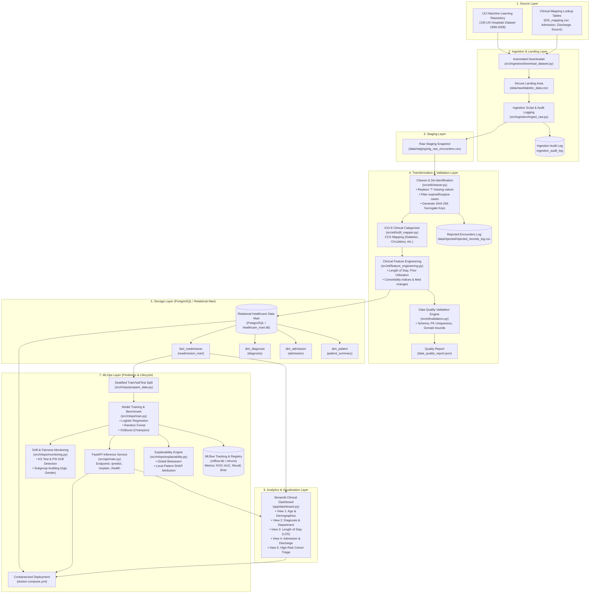
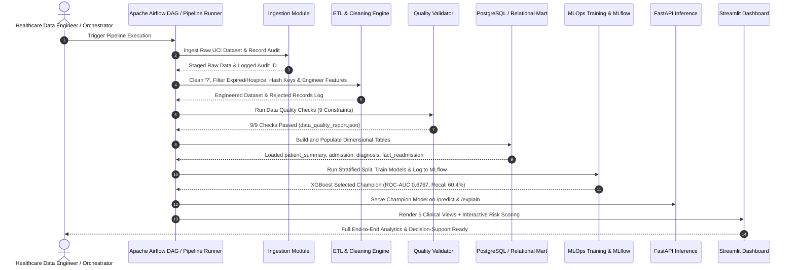

# Hospital Readmission Analytics & Prediction - Architecture Design

## 1. High-Level Multi-Tier Architecture Diagram

## 2. Orchestrated Pipeline Execution Flow

## 3. Layer Breakdown & Privacy Principles
* **Source Layer**: Public, anonymized UCI Diabetes 130-US Hospitals dataset.
* **Landing / Staging Layer**: Segregated landing zones (`data/raw/` and `data/staging/`) preserving exact raw extractions for reproducibility.
* **Transformation Layer**:
  - Replaces `?` characters with standard `NaN`/nulls.
  - Filters out deceased and hospice encounters (2,423 cases) who cannot be readmitted, preserving clinical validity.
  - Generates irreversible SHA-256 surrogate keys for HIPAA Safe Harbor compliance.
  - Standardizes diagnoses into CCS diagnostic categories.
* **Storage Layer**: Open-source relational dimensional model (PostgreSQL or SQLite data mart) structured into star schema (`patient_summary`, `admission`, `diagnosis`, `fact_readmission`).
* **Analytics Layer**: High-interactivity Streamlit application with 5 business views.
* **MLOps Layer**: Robust reproducible pipeline comparing Logistic Regression, Random Forest, and XGBoost; tracking experiments with MLflow; explaining predictions with SHAP; serving via FastAPI; containerized with Docker; monitored for data drift and demographic fairness.
