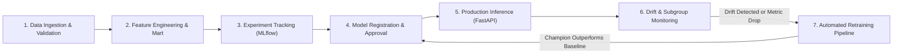

# Model Lifecycle, Drift Monitoring & Retraining Policy

## 1. Executive Summary
This document establishes the operational governance, continuous monitoring architecture, and automated retraining triggers for the Hospital Readmission Prediction service. In clinical machine learning, model performance degrades over time due to seasonal illness surges, changing clinical guidelines, shifting patient demographics, and modified discharge patterns.

---

## 2. Model Lifecycle Overview

### Stage Gate Criteria:
1. **Model Promotion Gate**: To replace the incumbent production model, a candidate challenger model must achieve:
   - Higher Test ROC-AUC (gain >= +0.01).
   - Higher sensitivity (Recall >= 58% at threshold 0.50, >= 85% at threshold 0.20).
   - Calibrated Brier Score <= 0.2200.
   - Fair subgroup performance with < 5% recall disparity across gender and elderly cohorts.

---

## 3. Continuous Monitoring Framework

### A. Data Drift Monitoring
Monitors shifting patient intake distributions between the training reference baseline ($X_{train}$) and incoming production encounter batches ($X_{prod}$).

* **Numerical Features** (Length of Stay, Prior Inpatient Admissions, Medication Count, Diagnosis Count):
  - **Statistical Test**: Two-sample Kolmogorov-Smirnov (KS) test.
  - **Threshold**: KS statistic $> 0.10$ with $p$-value $< 0.01$.
  - **Metric**: Population Stability Index (PSI):
    $$\text{PSI} = \sum_{i=1}^{k} (A_i - E_i) \times \ln\left(\frac{A_i}{E_i}\right)$$
    - $\text{PSI} < 0.10$: Negligible shift (Nominal).
    - $0.10 \le \text{PSI} < 0.20$: Moderate shift (Warning).
    - $\text{PSI} \ge 0.20$: Significant distribution drift (Alert).

* **Categorical Features** (Admission category, Discharge destination, ICD-9 Primary diagnosis):
  - **Statistical Test**: Chi-square goodness-of-fit test and categorical frequency drift ($p < 0.01$).

### B. Subgroup Fairness & Clinical Calibration Auditing
Healthcare decision-support models must guarantee equitable diagnostic accuracy across protected and vulnerable cohorts.
The monitoring engine evaluates:
1. **Elderly Subgroup ($\ge 65$ years vs $<65$ years)**:
   - Evaluates True Positive Rate (Recall) parity: $|TPR_{\ge 65} - TPR_{< 65}| \le 0.06$.
   - Brier score calibration parity: $|Brier_{\ge 65} - Brier_{< 65}| \le 0.03$.
2. **Gender Subgroups (Female vs Male)**:
   - Equalized Odds and Demographic parity disparity: $\le 0.05$.

---

## 4. Retraining Trigger Matrix

| Trigger Type | Metric / Event | Threshold | Action |
|---|---|---|---|
| **Scheduled Cadence** | Time Elapsed | Every 90 days (Quarterly) | Scheduled retraining run on latest 12-month trailing encounters |
| **Statistical Drift** | Number of drifting features | $\ge 2$ features with $\text{PSI} \ge 0.20$ | Automated notification to ML engineer + trigger candidate training |
| **Performance Degradation** | Brier Calibration Loss | Brier score increases by $> 15\%$ | High-priority retraining trigger |
| **Sensitivity Drop** | Test/Validation Recall | Recall drops by $> 5\%$ on trailing 30d cohort | Immediate rollback to fallback heuristics + retraining |
| **Schema / Code Change** | ICD-10 update or hospital EHR change | Any new unmapped codes $> 1\%$ | Immediate pipeline pause & mapping update |

---

## 5. Retraining & Deployment Procedure
1. **Automated Pipeline Trigger**: Airflow or CI/CD invokes `python src/mlops/train.py`.
2. **Experiment Tracking**: MLflow logs all hyperparameters, ROC/PR curves, and calibration metrics under a new run ID.
3. **Automated Champion-Challenger Evaluation**:
   - The script compares challenger metrics against the registered champion metadata in `artifacts/models/model_metadata.json`.
   - If the challenger beats the incumbent champion on the validation gate, artifacts are serialized and version incremented (`v1.0.0` $\to$ `v1.1.0`).
4. **Zero-Downtime Deployment**:
   - Containerized FastAPI service reloads model weights via `/health` or rolling container update without interruption to hospital operations.
